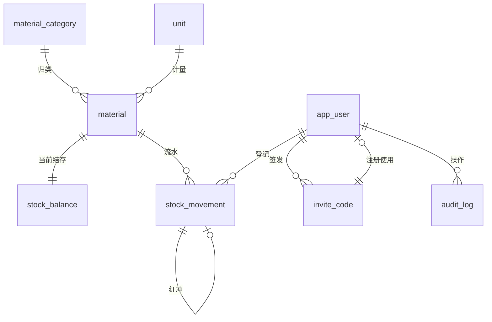
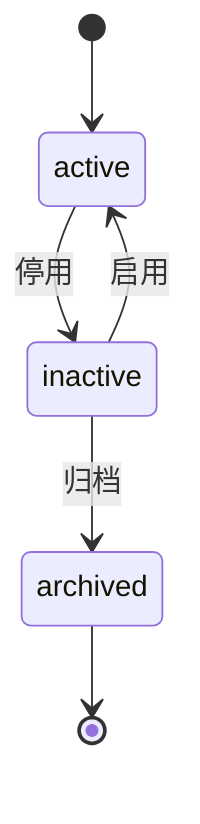
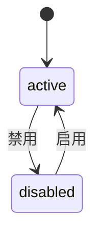
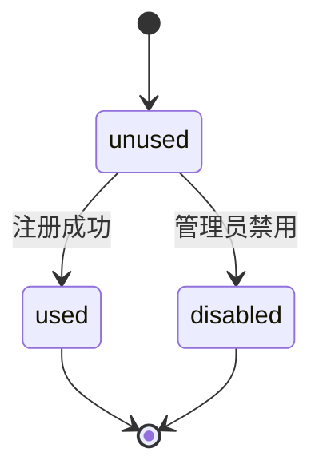

# DES-001 领域模型

这份文档回答一个问题：**库存这件事，在库里到底存成什么样。**

它是 S3 建表与写代码的唯一依据：表名、字段名、约束、不变式都在这里定死，代码不得自创。本文属 H1 决策类，须开发者审定后方可作为接口与实现的前提。

## 1. 目标与非目标

| 项 | 内容 |
|---|---|
| 本文件解决 | 物料、分类、单位、流水、结存、账号、邀请码、审计的记录结构，以及它们之间的不变式 |
| 本文件不解决 | 接口形状（`DES-002`）、界面（`DES-003`）、指标公式（`DES-004`，下一轮编写） |

## 2. 实体总览



八张表。相对 GOV-000 §1.3 的六表，新增 `unit`（D-06）与 `invite_code`（Q-1 采纳 A）。表数口径由"七表"更新为"八表"，已在 §6 记录裁定。

## 3. 表定义

### 3.1 通用列（除 `audit_log` 外每张表都有）

| 列 | 类型 | 约束 | 说明 |
|---|---|---|---|
| `id` | `uuid` | PK，应用侧生成 UUID v7 | 禁止数据库自增；UUID v7 保证时间有序，利于索引 |
| `created_at` | `timestamptz` | NOT NULL，默认 `now()` | 创建时间 |
| `updated_at` | `timestamptz` | NOT NULL，默认 `now()` | 由 `MetaObjectHandler` 维护 |
| `created_by` | `uuid` | NULL，FK → `app_user.id` | 系统初始化数据可为空 |
| `updated_by` | `uuid` | NULL，FK → `app_user.id` | 同上 |

### 3.2 `material_category` 分类字典

| 列 | 类型 | 约束 | 说明 |
|---|---|---|---|
| `name` | `varchar(50)` | NOT NULL，与 `parent_id` 联合唯一 | 分类名 |
| `sort_order` | `smallint` | NOT NULL，默认 0 | 列表排序，小的在前 |
| `parent_id` | `uuid` | NULL，自引用 | MVP 只用一级，字段保留 |
| `status` | `varchar(16)` | NOT NULL，`active` / `inactive` | 停用后不出现在筛选器 |

### 3.3 `unit` 单位字典

| 列 | 类型 | 约束 | 说明 |
|---|---|---|---|
| `name` | `varchar(20)` | NOT NULL，UNIQUE | 袋、瓶、千克 |
| `sort_order` | `smallint` | NOT NULL，默认 0 | 同上 |
| `status` | `varchar(16)` | NOT NULL，`active` / `inactive` | 已被物料引用的单位不得停用 |

### 3.4 `material` 物料

| 列 | 类型 | 约束 | 说明 |
|---|---|---|---|
| `code` | `varchar(32)` | NULL，UNIQUE（部分索引，排除软删行） | 可选自编码 |
| `name` | `varchar(80)` | NOT NULL | 物料名 |
| `category_id` | `uuid` | NOT NULL，FK → `material_category.id` | |
| `unit_id` | `uuid` | NOT NULL，FK → `unit.id` | 计量单位 |
| `spec` | `varchar(50)` | NULL | 规格，不参与计算 |
| `safety_stock` | `numeric(14,3)` | NOT NULL，默认 0，`>= 0` | 低于此值进预警清单 |
| `shelf_life_days` | `integer` | NULL，`> 0` | 保质期天数；MVP 只记录，不做临期预警 |
| `image_url` | `varchar(255)` | NULL | 对象存储 key，非公网 URL |
| `note` | `varchar(200)` | NULL | |
| `status` | `varchar(16)` | NOT NULL，`active` / `inactive` / `archived` | 状态机见 §4.3 |
| `version` | `integer` | NOT NULL，默认 0 | 乐观锁 |

### 3.5 `stock_movement` 流水

| 列 | 类型 | 约束 | 说明 |
|---|---|---|---|
| `material_id` | `uuid` | NOT NULL，FK → `material.id` | |
| `type` | `varchar(16)` | NOT NULL，`IN` / `OUT` / `ADJUST` / `REVERSAL` | |
| `quantity` | `numeric(14,3)` | NOT NULL，`<> 0` | **带符号**：`IN` 为正，`OUT` 为负，`ADJUST` 为差额，`REVERSAL` 与原流水相反 |
| `occurred_at` | `timestamptz` | NOT NULL | 业务发生时间，可与 `created_at` 不同（补录） |
| `operator_id` | `uuid` | NOT NULL，FK → `app_user.id` | 登记人 |
| `note` | `varchar(200)` | NULL | 红冲时必填原因 |
| `reversed` | `boolean` | NOT NULL，默认 `false` | 该流水是否已被红冲；**仅供展示**，不影响求和不参与计算 |
| `reversal_of` | `uuid` | NULL，FK → `stock_movement.id`，UNIQUE（部分索引） | 本条红冲指向的原流水；一条原流水最多被红冲一次 |

> 流水一经写入不得 `UPDATE`（`reversed` 除外）与 `DELETE`。修正只能靠红冲。这条由数据库触发器与应用层双重保证。

### 3.6 `stock_balance` 结存

| 列 | 类型 | 约束 | 说明 |
|---|---|---|---|
| `material_id` | `uuid` | NOT NULL，UNIQUE，FK → `material.id` | 一物料一行 |
| `quantity` | `numeric(14,3)` | NOT NULL，默认 0 | 当前结存，允许为负（见 §4.1 例外） |
| `last_movement_at` | `timestamptz` | NULL | 最近一次流水的 `occurred_at`，用于呆滞判定 |
| `version` | `integer` | NOT NULL，默认 0 | 乐观锁，写流水时递增 |

### 3.7 `app_user` 账号

| 列 | 类型 | 约束 | 说明 |
|---|---|---|---|
| `username` | `varchar(32)` | NOT NULL，UNIQUE | 登录名，小写字母数字下划线 |
| `display_name` | `varchar(50)` | NOT NULL | 界面显示名 |
| `password_hash` | `varchar(100)` | NOT NULL | 单向哈希（BCrypt），红线 5 |
| `role` | `varchar(16)` | NOT NULL，`admin` / `editor` / `viewer` | |
| `status` | `varchar(16)` | NOT NULL，`active` / `disabled` | 见 §4.4 |
| `must_change_password` | `boolean` | NOT NULL，默认 `false` | 口令重置后置真 |
| `password_updated_at` | `timestamptz` | NULL | 上次改密时间 |

> 不存手机号、身份证等敏感信息（硬边界 3）。

### 3.8 `invite_code` 邀请码

| 列 | 类型 | 约束 | 说明 |
|---|---|---|---|
| `code` | `varchar(8)` | NOT NULL，UNIQUE | 8 位加密随机字符 |
| `status` | `varchar(16)` | NOT NULL，`unused` / `used` / `disabled` | 见 §4.5 |
| `created_by` | `uuid` | NOT NULL，FK → `app_user.id` | 签发人 |
| `used_by` | `uuid` | NULL，FK → `app_user.id` | 使用者 |
| `used_at` | `timestamptz` | NULL | |

### 3.9 `audit_log` 审计

| 列 | 类型 | 约束 | 说明 |
|---|---|---|---|
| `actor_id` | `uuid` | NULL，FK → `app_user.id` | 系统任务为空 |
| `action` | `varchar(32)` | NOT NULL | `CREATE` / `UPDATE` / `PLACE` / `REVERSE` / `LOGIN` / `RESET_PASSWORD` 等 |
| `entity` | `varchar(32)` | NOT NULL | 表名 |
| `entity_id` | `uuid` | NOT NULL | 目标行 id |
| `before` | `jsonb` | NULL | 变更前快照 |
| `after` | `jsonb` | NULL | 变更后快照 |
| `created_at` | `timestamptz` | NOT NULL，默认 `now()` | 本表无 `updated_*` |

## 4. 关键约束与不变式

### 4.1 结存恒等式（最重要）

对任一物料 m：

```
stock_balance(m).quantity == Σ stock_movement(m).quantity
```

其中求和**包含**已被红冲的原流水与红冲流水本身——原流水保留在账上，红冲流水以相反符号将其抵消。因此 `reversed` 只用于展示，**不参与任何计算**，这条是防止"红冲一次扣两次"的唯一保险。

例外：允许结存为负（Q-2 已裁定采纳 A）。理由是不强制"出库不得超过结存"——业务上先领后补很常见。数据库层不加 `>= 0` 约束；若日后要拦截，属业务规则变更，须走 RFC 并回改 PRD 验收。

### 4.2 流水不改不删

| 编号 | 不变式 | 保证方式 |
|---|---|---|
| I-1 | 流水写入后 `quantity`、`type`、`material_id`、`occurred_at` 不可改 | 触发器 `BEFORE UPDATE` 拒绝 |
| I-2 | 流水不可删除 | 触发器 `BEFORE DELETE` 拒绝；仅允许级联于物料物理删除（本项目不物理删物料） |
| I-3 | 一条原流水最多被红冲一次 | `reversal_of` 部分唯一索引 |
| I-4 | 红冲流水的 `quantity` 必须等于原流水的相反数 | 触发器校验 |
| I-5 | 结存必须等于流水求和 | 每日对账任务校验；发现差异告警，不自动修 |

### 4.3 物料状态机



`archived` 为终态，不可逆。停用与归档的物料其流水与统计仍保留。

### 4.4 账号状态机



`must_change_password` 为真时，除改密接口外一律 403。

### 4.5 邀请码状态机



三种无效码（不存在 / 已使用 / 已禁用）对外返回同一错误码，不得区分原因（D-18）。

### 4.6 单位不相加

不同单位的数量不得相加（红线 9）。数据库不提供跨物料求和视图；统计只能按 `unit_id` 分组或计数，见 `DES-004`。

## 5. 索引

| 表 | 索引 | 用途 |
|---|---|---|
| `material` | `(category_id, status)` | 列表按分类筛选 |
| `material` | `(name)` trigram 或 `text_pattern_ops` | 名称模糊搜索 |
| `material` | UNIQUE `(code)` WHERE `code IS NOT NULL` | 编码唯一 |
| `stock_movement` | `(material_id, occurred_at DESC)` | 物料详情时间线 |
| `stock_movement` | `(occurred_at)` | 全量趋势与对账 |
| `stock_movement` | UNIQUE `(reversal_of)` WHERE `reversal_of IS NOT NULL` | 一条原流水只能红冲一次 |
| `stock_balance` | UNIQUE `(material_id)` | 一物料一行 |
| `stock_balance` | `(quantity)` WHERE `quantity <= 0` 部分索引 | 零库存与负库存查询 |
| `audit_log` | `(entity, entity_id, created_at DESC)` | 按对象追审计 |
| `invite_code` | UNIQUE `(code)` | 校验邀请码 |

## 6. 裁定记录

| 编号 | 事项 | 裁定 | 日期 |
|---|---|---|---|
| Q-1 | 邀请码是否独立成表 | **采纳 A：独立表 `invite_code`**。理由：D-18 要求"未使用的邀请码可由管理员禁用"，放 `app_user` 字段无法管理未使用的码；复用 `audit_log` 语义不符。连带影响：表数由"七表"改为"八表"，R-01 的修订范围同步扩大 | 2026-11-01 |
| Q-2 | 出库是否允许结存为负 | **采纳 A：允许**。数据库不加非负约束，负结存按实际显示 | 2026-11-01 |
| Q-3 | `shelf_life_days` 是否保留 | **采纳 A：保留字段，不做临期预警**。仅为后续"批次与效期"留最小接口，不构成预埋实现 | 2026-11-01 |

> 上述三项为 H1 决策类，由开发者 2026-11-01 审定。本文档其余内容仍待整体审定。

## 7. 追溯

| 本文件的结论 | 依据 |
|---|---|
| 八表结构与字段 | GOV-000 §1.3 六表 + D-06（`unit`）+ D-13/D-18（邀请码） |
| `password_hash` 单向哈希 | D-17；红线 5 |
| 流水无盘点批次列 | D-07 |
| `reversed` 不参与计算 | 本文件 §4.1 首次明确，属新增规则，请重点核对 |
| 单位不相加 | 红线 9 |

## 8. 变更记录

| 日期 | 变更 | 依据 |
|---|---|---|
| 2026-11-01 | 初版建立 | ITER-20261101-05 |
| 2026-11-01 | 依 Q-1/Q-2/Q-3 裁定回写：确认八表、负结存允许、`shelf_life_days` 保留；§6 由「待审定项」改为「裁定记录」 | ITER-20261101-06 |
