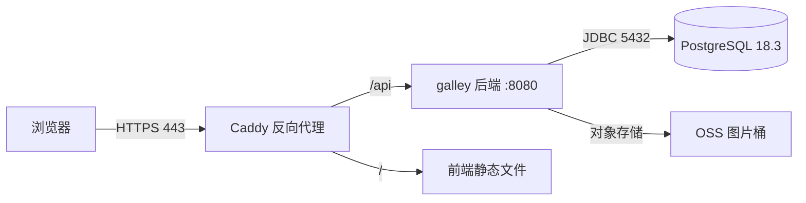

# OPS-001 部署

这份文档回答一个问题：**代码从 main 到线上，中间经过哪几步、每步看什么。**

## 1. 拓扑

MVP 为单机 Docker 部署，生产环境定在阿里云（S5 定稿）。当前形态：



| 组件 | 形态 | 说明 |
|---|---|---|
| Caddy | 容器 | 终结 TLS，按路径分流；配置见 `infra/proxy/Caddyfile` |
| galley 后端 | 容器，JRE 25 | 单实例；健康检查 `/actuator/health/readiness` |
| 前端 | 静态文件 | 由 Caddy 直接托管 `dist/` |
| PostgreSQL | 容器 + 数据卷 | 每日备份，见 `RUN-002` |
| OSS | 阿里云对象存储 | 物料图片；后端只存 key，不存公网 URL |

**待确认项**（S5 定稿前不阻塞开发）：ECS 实例规格、域名与证书来源、OSS bucket 地域。

> **本文档当前不作为 S2 交付物。** 开发者尚未采购服务器，部署拓扑留待 S5 定稿，本轮不参与审定。

## 2. 环境

| 环境 | 用途 | 数据 | 访问 |
|---|---|---|---|
| local | 开发 | Docker 容器，可随意重建 | localhost |
| staging | 发布前验证 | 脱敏样例数据 | 内网 + 白名单 |
| prod | 线上 | 真实数据 | 公网 HTTPS |

**staging 与 prod 不共用数据库，不共用 OSS bucket。** 任何"临时在 prod 上试一下"都按红线处理。

## 3. 配置

全部通过环境变量注入，清单见 `.env.example`，CI 校验两者一致。

| 变量 | 必填 | 说明 |
|---|---|---|
| `GALLEY_ENV` | ✓ | `local` / `staging` / `prod` |
| `GALLEY_DB_URL`、`GALLEY_DB_USERNAME`、`GALLEY_DB_PASSWORD` | ✓ | 口令不入库、不入仓，由部署环境注入 |
| `GALLEY_SERVER_PORT` | — | 默认 8080；线上由 Caddy 固定转发，不覆盖 |
| `GALLEY_LOG_LEVEL` | — | 默认 `INFO`；排障时可临时 `DEBUG`，事后改回 |

## 4. 发布步骤

| 序 | 动作 | 命令 / 位置 | 预期 | 失败则 |
|---|---|---|---|---|
| 1 | 确认门禁 | CI 全绿、ITER 已审定 | 三项齐全 | 停止 |
| 2 | 打标签 | `git tag -a v<版本> -m "<摘要>"` | 标签指向 main 顶端 | 停止 |
| 3 | 构建镜像 | CI 产出 `galley:<版本>` | 镜像可拉取 | 停止 |
| 4 | 备份 | `RUN-002` §2 | 备份文件存在且校验通过 | 停止 |
| 5 | 迁移 | 启动时由 Flyway 自动执行 | 日志出现 `Successfully applied` | 见 `RUN-001` §3 |
| 6 | 滚动 | `docker compose -f compose.prod.yml up -d galley` | 容器 healthy | 回滚 |
| 7 | 冒烟 | `/healthz`、`/actuator/health/readiness`、登录一次 | 三者正常 | 回滚 |
| 8 | 记录 | `CHANGELOG.md` + ITER | 已记录 | — |

## 5. 回滚

镜像回滚（首选，秒级）：

```bash
docker compose -f infra/compose/compose.prod.yml up -d galley@<上一个镜像摘要>
```

数据库**不自动回滚**。迁移脚本按 `DEV-002` §6 拆成"先加新、再删旧"，因此旧版本代码通常能与新库共存。若必须回退库结构，走 `RUN-002` §4 的恢复流程，并记录事故。

## 6. 变更记录

| 日期 | 变更 | 依据 |
|---|---|---|
| 2026-11-01 | 初版建立；拓扑与步骤定稿，实例规格待 S5 | ITER-20261101-09 |
