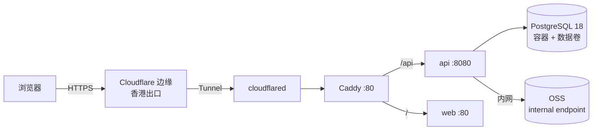

# OPS-001 部署

这份文档回答一个问题：**代码从 main 到线上，中间经过哪几步、每步看什么。**

## 1. 拓扑

单机 Docker 部署，ECS 在阿里云杭州。对外入口不走入站端口，而是由服务器主动连出的 **Cloudflare Quick Tunnel** 承载（临时方案，`*.trycloudflare.com`，无需域名与备案）。



| 组件 | 形态 | 说明 |
|---|---|---|
| Cloudflare | 外部服务 | 终结 TLS、分配临时域名；Tunnel 由服务器侧发起 |
| cloudflared | 容器 | `tunnel --url http://caddy:80`；**无需 token，也无需账号**，临时域名在日志里打印 |
| Caddy | 容器，内网 `:80` | 安全响应头、路径分流；**不再持有证书，ACME 配置不再使用** |
| api | 容器，`expose 8080` | 单实例；健康检查 `/actuator/health/readiness` |
| web | 容器，`expose 80` | nginx 托管前端构建产物 |
| PostgreSQL | 容器 + 数据卷 | 自建，备份见 `RUN-002`；无托管高可用 |
| OSS | 阿里云对象存储 | 物料图片；服务器经 `oss-cn-hangzhou-internal.aliyuncs.com` 内网访问 |

**端口面**：安全组入站只放行 22（限固定源 IP）；80 / 443 保持关闭。出站需允许 cloudflared 访问 Cloudflare 边缘的 443。

**已知风险 R-01：入口地址不稳定。** Quick Tunnel 的域名每次启动重新生成，`docker compose restart cloudflared` 或整机重启后旧地址立即失效；没有 SLA，Cloudflare 可随时限速或断开。取当前地址：

```bash
docker compose -f infra/compose/compose.prod.yml logs cloudflared | grep -o 'https://[a-z0-9-]*\.trycloudflare\.com' | tail -1
```

拿到地址的人都能访问，访问控制只能依赖应用自身的登录。域名与备案就绪后切 Named Tunnel，`DVT-13` 才可收回。

## 2. 环境

| 环境 | 用途 | 数据 | 访问 |
|---|---|---|---|
| local | 开发 | Docker 容器，可随意重建 | localhost |
| staging | 发布前验证、性能实测 | 脱敏样例数据或种子 | 与 prod 同机，`http://127.0.0.1:8081`（仅回环） |
| prod | 线上 | 真实数据 | 公网 HTTPS（临时域名，重启会变） |

**staging 与 prod 不共用数据库，不共用 OSS bucket。** 任何"临时在 prod 上试一下"都按红线处理。

staging 以独立项目名 `galley-staging` 与 prod 跑在同一台 ECS 上，靠三样东西隔离：**项目名、宿主端口、数据卷**。三者任一与 prod 重合都会串到生产，部署前先核对。

### 2.1 staging 的启停

覆盖层是 `infra/compose/compose.staging.yml`，只做三件事：改项目名、把 `api` 与 `caddy` 绑到宿主回环端口（8082 / 8081）、给 `cloudflared` 加 `tunnel` 档位默认不启动。

```bash
cd /opt/galley
# 起（第一次会拉镜像、跑 Flyway）
docker compose -p galley-staging \
  --env-file infra/compose/.env.staging \
  -f infra/compose/compose.prod.yml \
  -f infra/compose/compose.staging.yml up -d

# 看状态与端口
docker compose -p galley-staging ps
curl -fsS http://127.0.0.1:8081/actuator/health   # 经 caddy
curl -fsS http://127.0.0.1:8082/actuator/health   # 直连 api

# 停（数据卷保留）
docker compose -p galley-staging down
```

三点注意：

1. **不要省略 `-p galley-staging`**。少了它，Compose 会按目录名推导项目名，可能覆盖 prod 的容器与卷。
2. `cloudflared` 默认不启动。确需临时对外时追加 `--profile tunnel`，地址同样重启即变。
3. staging 的 `GALLEY_RECONCILE_CRON` 定为 `0 30 3 * * *`，与 prod 的 02:30 错开，避免同机争资源。

首次启动建议按 `db` → `api` → `web` `caddy` 分三步，每步之间看一眼内存：

```bash
... up -d --wait db
... up -d --wait api
... up -d --wait web caddy
```

同机 1740 MB 内存下，两套服务静态占用约 730 MB（prod 约 350 MB、staging 约 380 MB），剩余给页缓存与压测。一次性全起会把启动峰值叠在一起，分步便于确认哪一步吃掉了内存。

staging 首次启动同样会建管理员账号并打印随机口令，位置在 `docker compose -p galley-staging logs api`。

### 2.2 用 staging 验证未发版的代码

staging 默认用与 prod 相同的发布 tag。要验证还没发版的改动，构建一个临时镜像换上，**不要动 prod 的 `.env.prod`**：

```bash
# 1. 仓库根目录构建，tag 带日期与短哈希，避免与发布 tag 混淆
docker build -t ghcr.io/dust191/galley-api:dev-20261114-e96f312 backend/

# 2. 传到云主机并导入
docker save ghcr.io/dust191/galley-api:dev-20261114-e96f312 | ssh cloud 'docker load'

# 3. 只改 staging 的镜像变量，重启 api
sed -i 's|^GALLEY_IMAGE_API=.*|GALLEY_IMAGE_API=ghcr.io/dust191/galley-api:dev-20261114-e96f312|' \
  /opt/galley/infra/compose/.env.staging
docker compose -p galley-staging --env-file .env.staging \
  -f compose.prod.yml -f compose.staging.yml up -d api
```

验证完把 `GALLEY_IMAGE_API` 改回发布 tag，否则 staging 与 prod 的「同镜像」前提就不成立了。临时镜像用完删掉：`docker rmi <tag>`。

这条路径只在需要验未发版代码时走，常规验收仍用发布镜像。

### 2.3 镜像怎么进 ACR

发布镜像是双源的：GHCR 存构建产物，**ACR 才是部署源**。ECS 只从 ACR 的 `-vpc` 域名拉取——同一个 426 MB 的 api 镜像，内网拉取实测 3.7 秒，走公网拉 GHCR 要 4~10 分钟且会中途断开。

同步由流水线完成：打 tag 后 `images` job 构建推 GHCR，`acr-sync` job 把同一份镜像推进 ACR。补同步历史 tag：

```bash
gh workflow run release -f tag=v0.2.0   # 只同步，不重新构建
```

两个坑，都已在流水线里处理：

- ACR 个人版拒收带 attestation 的 OCI 索引，提交 manifest 报 `403 unknown manifest class for application/vnd.oci.empty.v1+json`。故构建端关闭 `provenance` 与 `sbom`，同步端按 amd64 单平台清单的 digest 定向拉取。
- 仓库所有者是 `Dust191`，而镜像名只接受小写，脚本内先做小写归一。

仓库密钥 `ACR_USERNAME` / `ACR_PASSWORD` 已配置。凭据同时存在于 ECS 部署账号的 `~/.docker/config.json` 与虚拟机的同名文件；**公网域名与 `-vpc` 域名各需一条登录记录**，Docker 按主机名区分注册表，少一条就是 `pull access denied`。

## 3. 配置

全部通过环境变量注入。真实值只存在服务器的 `.env.prod` 与 `.env.staging`，不入仓、不入镜像、不进日志。

**从模板复制，不要手写**：`infra/compose/.env.prod.example` 与 `.env.staging.example` 列出全部键与占位值，分别复制为 `/opt/galley/.env.prod` 与 `/opt/galley/infra/compose/.env.staging` 后改值即可。三条约定：

1. 含空格的值必须加引号（`GALLEY_RECONCILE_CRON="0 30 2 * * *"`）。不加引号时，任何脚本 `source` 本文件都会把值当命令执行，其后的变量全部变空。
2. 文件必须 LF 行尾。从 Windows 直接传会带 CRLF，值尾多一个 `\r`；compose 能容忍，shell 与 `ossutil` 不能，表现为 `invalid oss path` 这类看不出根因的错。
3. 改完先校验再启动：

```bash
docker compose --env-file /opt/galley/.env.prod \
  -f infra/compose/compose.prod.yml config -q

docker compose -p galley-staging --env-file infra/compose/.env.staging \
  -f infra/compose/compose.prod.yml -f infra/compose/compose.staging.yml config -q
```

`GALLEY_ENV`、`GALLEY_LOG_LEVEL`、`GALLEY_RECONCILE_CRON` 由编排透传给容器；此前这三个是写死的，改 `.env.prod` 不生效（`ITER-20261112-08`）。

| 变量 | 必填 | 说明 |
|---|---|---|
| `GALLEY_ENV` | ✓ | `prod` 或 `staging`；该值决定初始管理员是否允许重置口令 |
| `GALLEY_DB_URL`、`GALLEY_DB_USERNAME`、`GALLEY_DB_PASSWORD` | ✓ | 指向本机 `db` 容器；应用账号只授 DML |
| `GALLEY_S3_ENDPOINT` | ✓ | `https://oss-cn-hangzhou-internal.aliyuncs.com`（内网，不走公网） |
| `GALLEY_S3_ACCESS_KEY` / `GALLEY_S3_SECRET_KEY` | ✓ | 建议用只授权该 bucket 的 RAM 子账号 |
| `GALLEY_S3_BUCKET` | ✓ | 生产为 `jameshome-galley`，staging 用 `jameshome-galley-staging`；两桶独立，均为私有读 |
| `GALLEY_S3_PUBLIC_ENDPOINT` | ✓ | `https://oss-cn-hangzhou.aliyuncs.com`，只用于签发浏览器可访问的图片地址 |
| `GALLEY_S3_REGION` | ✓ | `cn-hangzhou`；签名必须带区域，否则会先发 `GetBucketLocation` |
| `GALLEY_S3_SIGNED_URL_TTL_SECONDS` | — | 图片地址有效期，默认 3600，上限 604800 |
| `GALLEY_S3_MAX_IMAGE_BYTES` | — | 默认 5 MB |
| `GALLEY_IMAGE_API` / `GALLEY_IMAGE_WEB` | ✓ | ACR 的 `-vpc` 域名加固定 tag，禁止 `latest`；tag 与 `pom.xml` 版本对齐 |
| `GALLEY_IMAGE_CADDY` | ✓ | `crpi-8wtwv1zju2g9kpgg.cn-hangzhou.personal.cr.aliyuncs.com/jameshome-galley/caddy:2-alpine` |
| `GALLEY_IMAGE_TUNNEL` | ✓ | 同 ACR 前缀下的 `cloudflared:2026.10.7`，不设默认值，缺失时编排直接报错 |
| `GALLEY_LOG_LEVEL` | — | prod 固定 `info`；排障临时 `debug` 后 2 小时内改回 |
| `GALLEY_RECONCILE_CRON` | — | 默认每日 02:30 |
| `GALLEY_BOOTSTRAP_ADMIN_USERNAME` | — | 默认 `admin`；空库首次启动生成随机口令并打印一次 |

`ACME_EMAIL` 与 `CLOUDFLARE_TUNNEL_TOKEN` 都不再需要：Quick Tunnel 不签发自定义证书，也不需要账号凭据。

## 4. 发布步骤

| 序 | 动作 | 命令 / 位置 | 预期 | 失败则 |
|---|---|---|---|---|
| 1 | 确认门禁 | CI 全绿、ITER 已审定、无 `p0/p1` 未决 | 三项齐全 | 停止 |
| 2 | 定版本 | 更新 `CHANGELOG`，`git tag -a v<版本>` | 标签指向 main 顶端 | 停止 |
| 3 | 构建并推送镜像 | `.github/workflows/release.yml`（打 tag 触发） | GHCR 出现两个 tag，`acr-sync` job 成功 | 停止 |
| 4 | 全量备份 | `/opt/galley/infra/backup/backup-db.sh`（脚本内含 OSS 回查） | 输出「备份成功」，远端 MD5 与本地一致 | 停止 |
| 5 | 迁移 | 启动时由 Flyway 自动执行 | 日志出现 `Successfully applied` | 见 `RUN-001` §3 |
| 6 | 替换容器 | `docker compose --env-file .env.prod -f infra/compose/compose.prod.yml up -d api web` | 新容器 healthy | 执行 §5 |
| 7 | 冒烟 | 容器内 readiness、登录（先取 CSRF 令牌）、列表、登记一条流水、导出 | 五项正常 | 执行 §5 |
| 8 | 观察与记录 | 盯 30 分钟；写 `CHANGELOG` 与 ITER | 无 5xx 抬升 | 执行 §5 |

GHCR 两个包已于 2026-11-12 设为 public。部署不再从 GHCR 拉取，公网可见性只影响备用路径；ACR 走内网，凭据见 §2.3。

第 6 步当前是**原地替换**，有秒级中断；规范要求的蓝绿（双 api 服务 + 切 Caddy upstream）尚未实现，属 S5 未完成项。

**第 6 步之后必须重新取入口地址**：只要 `cloudflared` 容器被重建或重启，旧地址即失效，按 §1 的 R-01 命令取新地址并通知使用者。

## 5. 回滚

应用回滚（首选）：

```bash
# 把镜像变量指回上一个 tag，只重建该服务；shell 变量优先于 --env-file
GALLEY_IMAGE_API=<上一 tag> docker compose --env-file /opt/galley/.env.prod \
  -f infra/compose/compose.prod.yml up -d --no-deps api
GALLEY_IMAGE_WEB=<上一 tag> docker compose --env-file /opt/galley/.env.prod \
  -f infra/compose/compose.prod.yml up -d --no-deps web
```

配置回滚：`.env.prod` 每次变更前留一份带日期的副本，回滚即换回上一份并重建容器。

数据库**只前滚，不回滚**。迁移按「先加新、再回填、下个版本删旧」拆开，旧代码能与新库共存；确实损坏时走 `RUN-002` §4 的恢复流程并记录事故。

## 6. 变更记录

| 日期 | 变更 | 依据 |
|---|---|---|
| 2026-11-01 | 初版建立；拓扑与步骤定稿，实例规格待 S5 | ITER-20261101-09 |
| 2026-11-12 | 按开发者决定重写：Cloudflare Tunnel 承接 TLS、数据库改自建容器、OSS 走内网 endpoint；修正代理路径、回滚命令与冒烟路径三处与实现不符的写法 | ITER-20261112-01 |
| 2026-11-12 | 入口改为 Cloudflare Quick Tunnel：去掉 token，临时域名由日志给出；新增 R-01（重启换址）并写入取址命令 | ITER-20261112-03 |
| 2026-11-12 | 补镜像构建产物与发布流水线说明；发布第 3 步改为 GHCR 包核对，并补首次发布后设可见性 | ITER-20261112-04 |
| 2026-11-12 | 发布步骤改为真实命令：备份走脚本、替换容器带 `--env-file`、冒烟含 CSRF 前置；GHCR 可见性记为已完成 | ITER-20261112-09 |
| 2026-11-14 | 新增 §2.1 staging 启停：同机独立项目名 `galley-staging`，回环端口 8081 / 8082，`cloudflared` 默认不起；补 `.env.staging.example` 与编排校验命令 | ITER-20261114-04 |
| 2026-11-14 | §2.1 补首次启动的三步顺序与实测内存占用；`updated` 同步 | ITER-20261114-05 |
| 2026-11-14 | 新增 §2.2：验证未发版代码时手动构建临时镜像，验证完改回发布 tag | ITER-20261114-06 |
| 2026-11-14 | 新增 §2.3：镜像由流水线同步进 ACR，ECS 只从 `-vpc` 域名拉取；发布第 3 步预期加 `acr-sync`；回滚命令补 `--env-file` | ITER-20261114-12 |