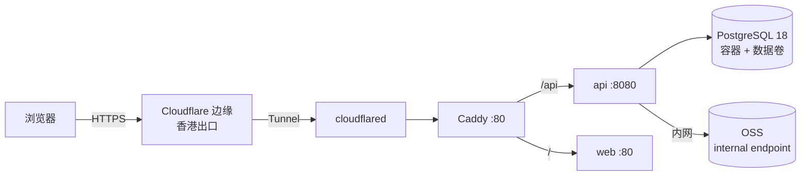

# OPS-001 部署

这份文档回答一个问题：**代码从 main 到线上，中间经过哪几步、每步看什么。**

当前为 S5 准备期版本：拓扑与资源口径已按 2026-11-12 的决定重写（`ITER-20261112-01`），镜像构建与编排仍在补齐。

## 1. 拓扑

单机 Docker 部署，ECS 在阿里云杭州。对外入口不走入站端口，而是由服务器主动连出的 **Cloudflare Quick Tunnel** 承载（临时方案，`*.trycloudflare.com`，无需域名与备案）。



| 组件 | 形态 | 说明 |
|---|---|---|
| Cloudflare | 外部服务 | 终结 TLS、分配临时域名；Tunnel 由服务器侧发起 |
| cloudflared | 容器 | `tunnel --url http://caddy:80`；**无需 token，也无需账号**，临时域名在日志里打印 |
| Caddy | 容器，内网 `:80` | 安全响应头、路径分流；**不再持有证书，ACME 配置不再使用** |
| api | 容器，`expose 8080` | 单实例；健康检查 `/actuator/health/readiness` |
| web | 容器，`expose 80` | nginx 托管前端构建产物 |
| PostgreSQL | 容器 + 数据卷 | 自建，备份见 `RUN-002`；无托管高可用 |
| OSS | 阿里云对象存储 | 物料图片；服务器经 `oss-cn-hangzhou-internal.aliyuncs.com` 内网访问 |

**端口面**：安全组入站只放行 22（限固定源 IP）；80 / 443 保持关闭。出站需允许 cloudflared 访问 Cloudflare 边缘的 443。

**已知风险 R-01：入口地址不稳定。** Quick Tunnel 的域名每次启动重新生成，`docker compose restart cloudflared` 或整机重启后旧地址立即失效；没有 SLA，Cloudflare 可随时限速或断开。取当前地址：

```bash
docker compose -f infra/compose/compose.prod.yml logs cloudflared | grep -o 'https://[a-z0-9-]*\.trycloudflare\.com' | tail -1
```

拿到地址的人都能访问，访问控制只能依赖应用自身的登录。域名与备案就绪后切 Named Tunnel，`DVT-13` 才可收回。

## 2. 环境

| 环境 | 用途 | 数据 | 访问 |
|---|---|---|---|
| local | 开发 | Docker 容器，可随意重建 | localhost |
| staging | 发布前验证 | 脱敏样例数据 | 另起一个 Quick Tunnel（端口不同即可） |
| prod | 线上 | 真实数据 | 公网 HTTPS（临时域名，重启会变） |

**staging 与 prod 不共用数据库，不共用 OSS bucket。** 任何"临时在 prod 上试一下"都按红线处理。

## 3. 配置

全部通过环境变量注入。真实值只存在服务器的 `.env.prod`，不入仓、不入镜像、不进日志。

| 变量 | 必填 | 说明 |
|---|---|---|
| `GALLEY_ENV` | ✓ | 固定 `prod`；该值决定初始管理员是否允许重置口令 |
| `GALLEY_DB_URL`、`GALLEY_DB_USERNAME`、`GALLEY_DB_PASSWORD` | ✓ | 指向本机 `db` 容器；应用账号只授 DML |
| `GALLEY_S3_ENDPOINT` | ✓ | `https://oss-cn-hangzhou-internal.aliyuncs.com`（内网，不走公网） |
| `GALLEY_S3_ACCESS_KEY` / `GALLEY_S3_SECRET_KEY` | ✓ | 建议用只授权该 bucket 的 RAM 子账号 |
| `GALLEY_S3_BUCKET` | ✓ | 待创建，命名见 `ITER-20261112-01` L-01；桶为私有读 |
| `GALLEY_S3_PUBLIC_ENDPOINT` | ✓ | `https://oss-cn-hangzhou.aliyuncs.com`，只用于签发浏览器可访问的图片地址 |
| `GALLEY_S3_REGION` | ✓ | `cn-hangzhou`；签名必须带区域，否则会先发 `GetBucketLocation` |
| `GALLEY_S3_SIGNED_URL_TTL_SECONDS` | — | 图片地址有效期，默认 3600，上限 604800 |
| `GALLEY_S3_MAX_IMAGE_BYTES` | — | 默认 5 MB |
| `GALLEY_IMAGE_API` / `GALLEY_IMAGE_WEB` | ✓ | 固定 tag，禁止 `latest`；tag 与 `pom.xml` 版本对齐 |
| `GALLEY_IMAGE_CADDY` | ✓ | ACR 中的 caddy 地址（由 Hub 转存，`T5-04`） |
| `GALLEY_IMAGE_TUNNEL` | ✓ | cloudflared 的固定 tag，不设默认值，缺失时编排直接报错 |
| `GALLEY_LOG_LEVEL` | — | prod 固定 `info`；排障临时 `debug` 后 2 小时内改回 |
| `GALLEY_RECONCILE_CRON` | — | 默认每日 02:30 |
| `GALLEY_BOOTSTRAP_ADMIN_USERNAME` | — | 默认 `admin`；空库首次启动生成随机口令并打印一次 |

`ACME_EMAIL` 与 `CLOUDFLARE_TUNNEL_TOKEN` 都不再需要：Quick Tunnel 不签发自定义证书，也不需要账号凭据。

## 4. 发布步骤

| 序 | 动作 | 命令 / 位置 | 预期 | 失败则 |
|---|---|---|---|---|
| 1 | 确认门禁 | CI 全绿、ITER 已审定、无 `p0/p1` 未决 | 三项齐全 | 停止 |
| 2 | 定版本 | 更新 `CHANGELOG`，`git tag -a v<版本>` | 标签指向 main 顶端 | 停止 |
| 3 | 构建并推送镜像 | `.github/workflows/release.yml` | `api` / `web` 两个 tag 可拉取 | 停止 |
| 4 | 全量备份 | `RUN-002` §2，并在 OSS 校验对象存在 | 备份文件非空、`pg_restore -l` 通过 | 停止 |
| 5 | 迁移 | 启动时由 Flyway 自动执行 | 日志出现 `Successfully applied` | 见 `RUN-001` §3 |
| 6 | 替换容器 | `docker compose -f compose.prod.yml up -d api web` | 新容器 healthy | 执行 §5 |
| 7 | 冒烟 | `/actuator/health/readiness`、登录、列表、登记一条流水、导出 | 五项正常 | 执行 §5 |
| 8 | 观察与记录 | 盯 30 分钟；写 `CHANGELOG` 与 ITER | 无 5xx 抬升 | 执行 §5 |

第 6 步当前是**原地替换**，有秒级中断；规范要求的蓝绿（双 api 服务 + 切 Caddy upstream）尚未实现，属 S5 未完成项。

**第 6 步之后必须重新取入口地址**：只要 `cloudflared` 容器被重建或重启，旧地址即失效，按 §1 的 R-01 命令取新地址并通知使用者。

## 5. 回滚

应用回滚（首选）：

```bash
# 把镜像变量指回上一个 tag，只重建该服务
GALLEY_IMAGE_API=<上一 tag> docker compose -f infra/compose/compose.prod.yml up -d --no-deps api
GALLEY_IMAGE_WEB=<上一 tag> docker compose -f infra/compose/compose.prod.yml up -d --no-deps web
```

配置回滚：`.env.prod` 每次变更前留一份带日期的副本，回滚即换回上一份并重建容器。

数据库**只前滚，不回滚**。迁移按「先加新、再回填、下个版本删旧」拆开，旧代码能与新库共存；确实损坏时走 `RUN-002` §4 的恢复流程并记录事故。

## 6. 变更记录

| 日期 | 变更 | 依据 |
|---|---|---|
| 2026-11-01 | 初版建立；拓扑与步骤定稿，实例规格待 S5 | ITER-20261101-09 |
| 2026-11-12 | 按开发者决定重写：Cloudflare Tunnel 承接 TLS、数据库改自建容器、OSS 走内网 endpoint；修正代理路径、回滚命令与冒烟路径三处与实现不符的写法 | ITER-20261112-01 |
| 2026-11-12 | 入口改为 Cloudflare Quick Tunnel：去掉 token，临时域名由日志给出；新增 R-01（重启换址）并写入取址命令 | ITER-20261112-03 |
