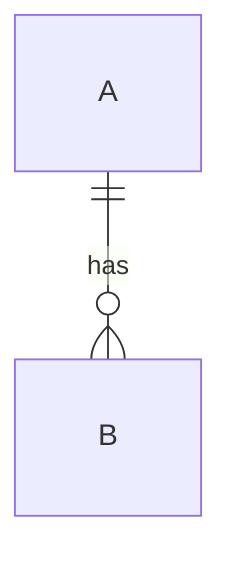

# DES-000 设计文档标题

这份文档回答一个问题：**（如：数据怎么存、接口怎么定、界面怎么组织）**

<!--
设计类文档的额外要求：
1. 每条设计结论必须能追溯到 PRD 的故事编号或 glossary 词条
2. 表、字段、接口、页面的名字必须与 glossary 英文名一致（G-3）
3. 涉及取舍时写"为什么不选另一个"，不写"这样更优雅"
4. 状态机与流程用 Mermaid，禁止文字堆叠
-->

## 1. 目标与非目标

| 项 | 内容 |
|---|---|
| 本文件解决 | |
| 本文件不解决 | （指向其它文档编号） |

## 2. 设计主体

### 2.1 结构

### 2.2 明细

| 名称 | 类型 | 约束 | 说明 |
|---|---|---|---|
| | | | |

## 3. 关键规则

<!-- 不变式、约束、并发与边界条件 -->

| 编号 | 规则 | 违反后果 |
|---|---|---|
| R-1 | | |

## 4. 取舍说明

| 选项 | 代价 | 为何不选 |
|---|---|---|
| | | |

## 5. 追溯

| 本文件的结论 | 依据（PRD / glossary / ADR） |
|---|---|
| | |

## 6. 变更记录

| 日期 | 变更 | 依据 |
|---|---|---|
| YYYY-MM-DD | 初版建立 | ITER-YYYYMMDD-NN |
